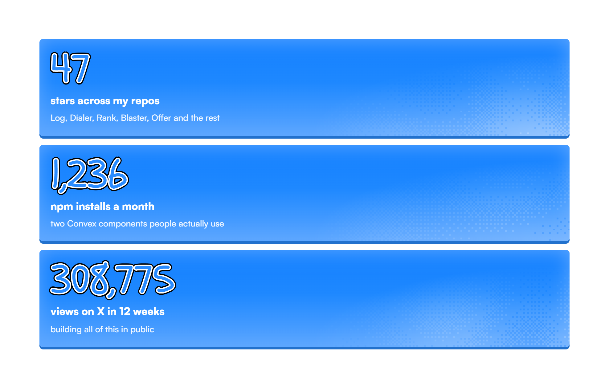
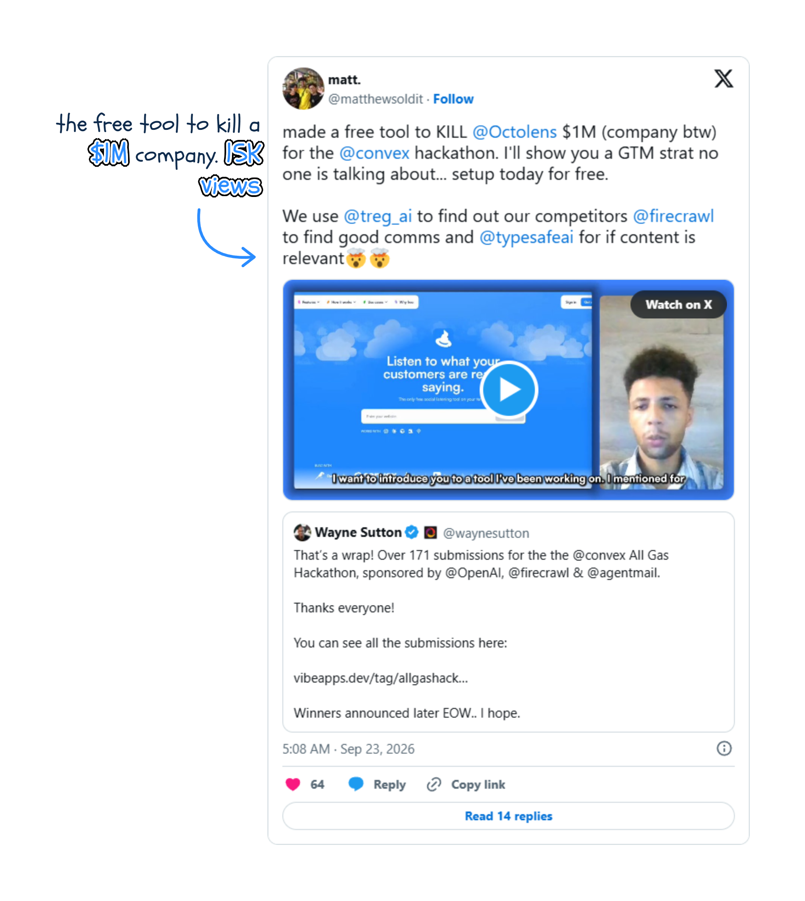
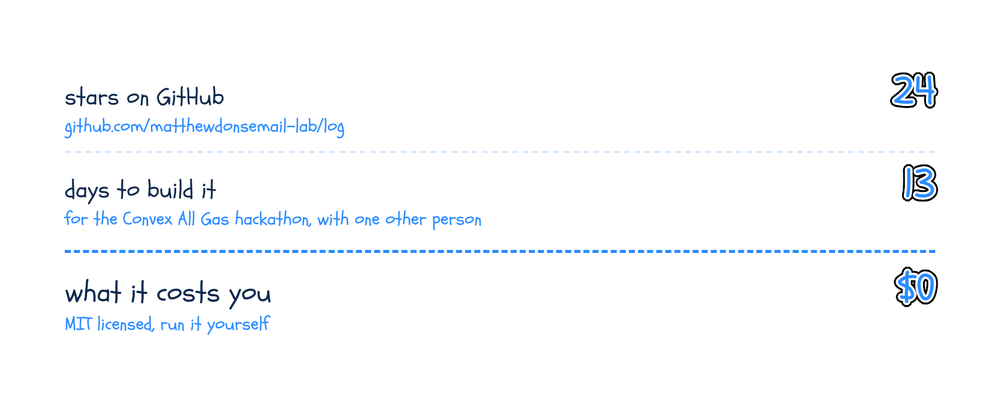
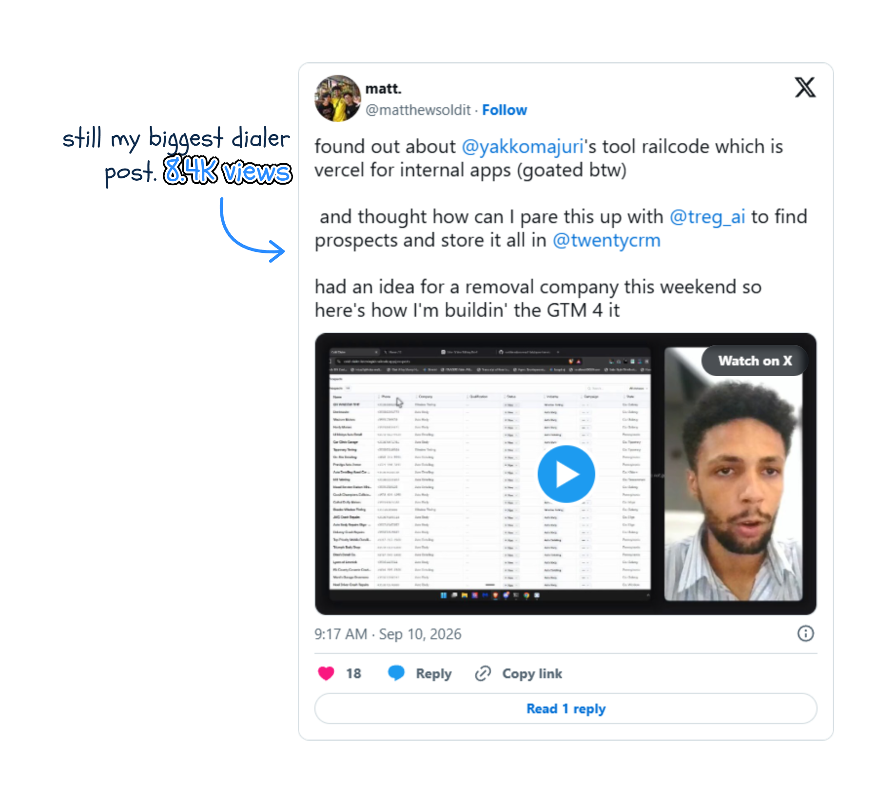
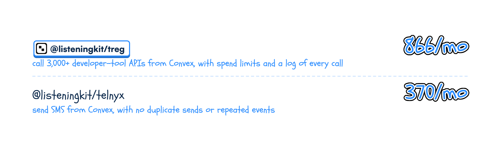
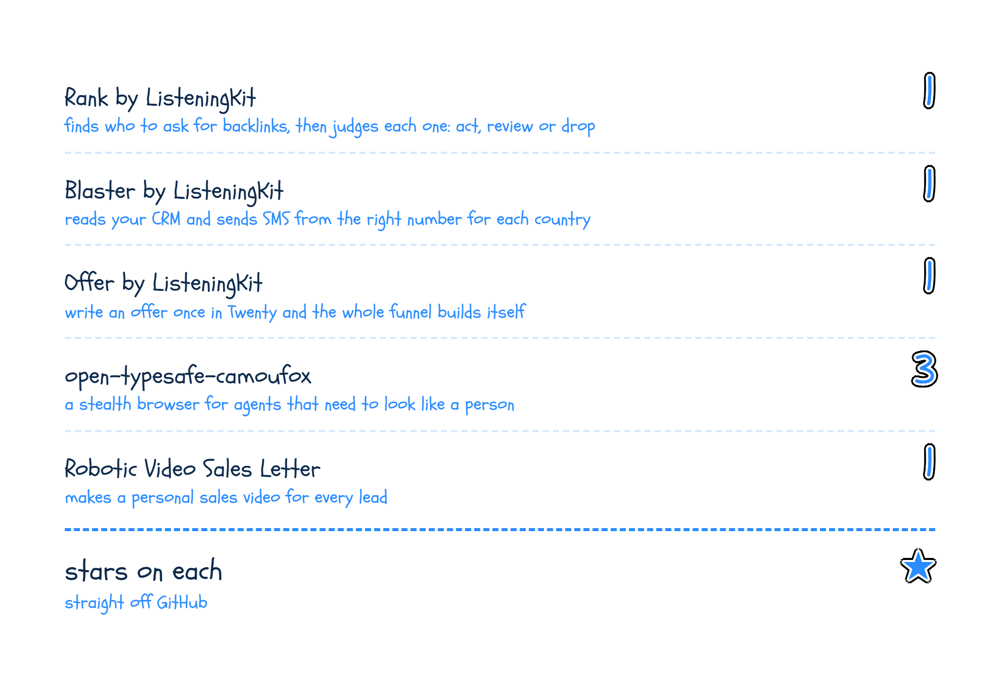
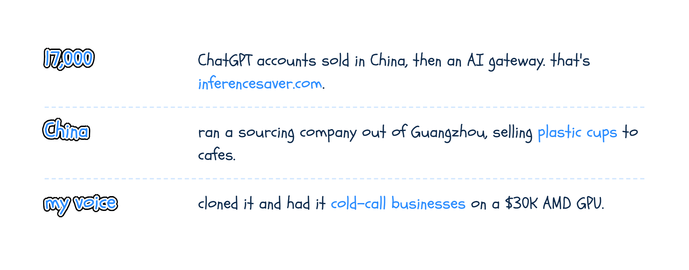
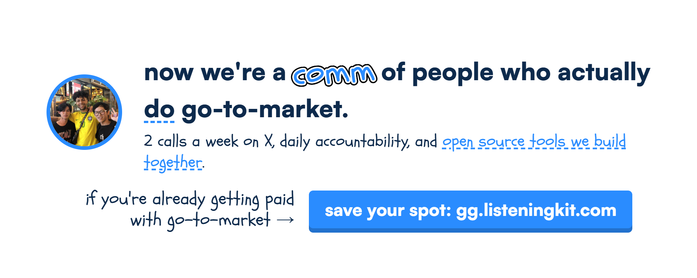

  

# i build go-to-market tools and give them away

I'm Matt. I do go-to-market: social, content, websites and the engineering behind it. **Everything I build for it goes open source**, and the numbers do the talking. Here's every tool and every number.

  

## The numbers so far

I don't think go-to-market tools should sit behind a paywall. So I build them **in the open**, ship them free, and let the numbers talk.

  

## I lost a hackathon. People starred it anyway.

**[Log by ListeningKit](https://github.com/matthewdonsemail-lab/log)** watches Reddit, X and Facebook for the things your customers say, scores every post **0 to 100** for buying intent, and pings you. Built in **13 days** for the [@convex](https://x.com/convex) All Gas hackathon, on [@treg_ai](https://x.com/treg_ai), [@firecrawl](https://x.com/firecrawl) and [@OpenAI](https://x.com/OpenAI).

  

We lost to another AI note-taking app. But that was never the point. We built Log to show what **open-source go-to-market** looks like, and to push tools that are actually good.

  

## A cold-calling dialer with no database of its own

**[Dialer by ListeningKit](https://github.com/matthewdonsemail-lab/dialer)** is the open-source version of the dialers you pay a fortune for. Your leads, scripts and calls all live in [Twenty CRM](https://x.com/twentycrm), and every call goes from the browser, **recorded and transcribed**.

  

  

I use it for our own sales reps. **8 stars** and counting.

## The bits people actually install

Every product I build, I pull the useful part out into a **Convex component** anyone can drop in. Two of them get installed every single day:

  

- [`@listeningkit/treg`](https://www.npmjs.com/package/@listeningkit/treg): call 3,000+ developer-tool APIs from Convex, with spend limits and a log of every call.
- [`@listeningkit/telnyx`](https://www.npmjs.com/package/@listeningkit/telnyx): send SMS from Convex, with no duplicate sends or repeated events.

  

## And the rest of the toolbox

Each one started because I needed it for a real campaign. **All open source.**

  

- [Rank](https://github.com/matthewdonsemail-lab/rank): finds who to ask for backlinks, then judges each one: act, review or drop.
- [Blaster](https://github.com/matthewdonsemail-lab/blaster): reads your CRM and sends SMS from the right number for each country.
- [Offer](https://github.com/matthewdonsemail-lab/offer): write an offer once in Twenty and the whole funnel builds itself.
- [open-typesafe-camoufox](https://github.com/matthewdonsemail-lab/open-typesafe-camoufox): a stealth browser for agents that need to look like a person.
- [Robotic Video Sales Letter](https://github.com/matthewdonsemail-lab/Robotic-Video-Sales-Letter-Pydantic-Camoufox-Agent-for-GTM): makes a personal sales video for every lead.

## Before all this

I dropped out of uni. I was already editing for creators with **300K to 10M followers**, then ChatGPT came out and I went all in. Since then:

  

## Now we're a comm

The people who use this stuff for real are a **comm** now: 2 calls a week on X, daily accountability, and open source tools we build together. If you're already getting paid with go-to-market, come in.

  

## Find me

- **X**: [@matthewsoldit](https://x.com/matthewsoldit) (where i make GTM devlogs)
- **ListeningKit**: [listeningkit.com](https://listeningkit.com/) (hire us to make sites and CRM plz)
- **LinkedIn**: [matt-don-132ab9435](https://www.linkedin.com/in/matt-don-132ab9435/) (trying to become LI final boss)
- **GitHub**: follow plz, i post my GTM strats here

Stars and npm installs checked 19 Oct 2026 (GitHub API, npm last 30 days). X views from 23 Jul to 14 Oct 2026.
