

  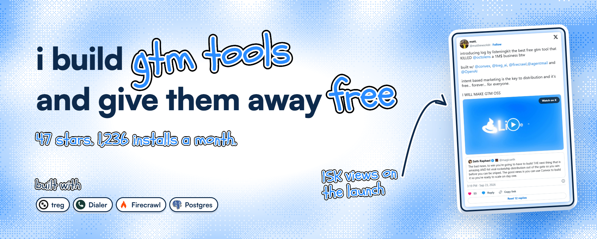

  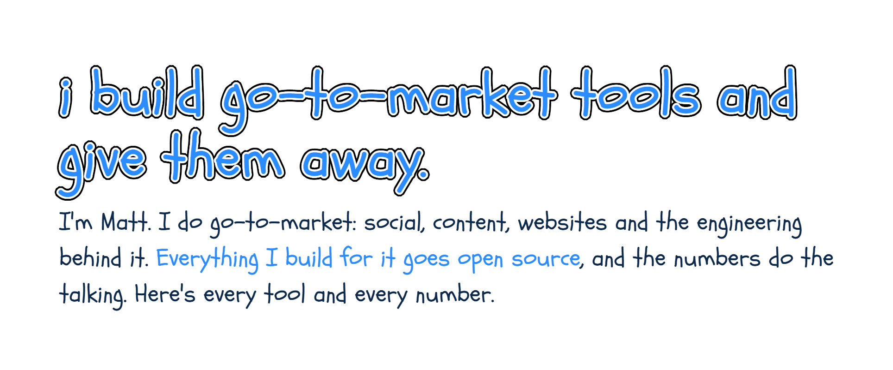

  <a href="https://x.com/matthewsoldit/status/2102674211424854426">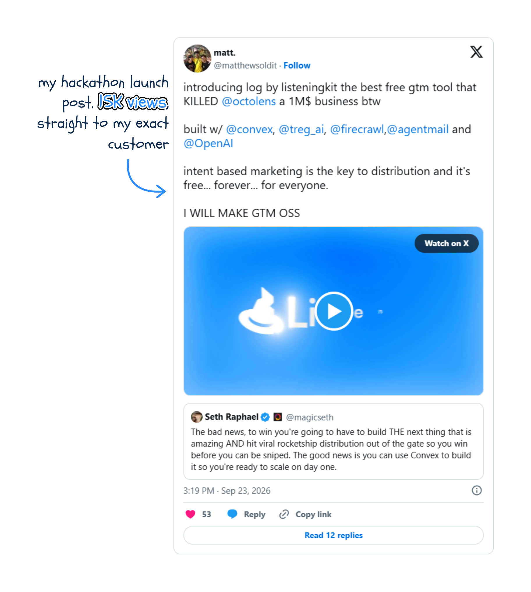</a>

  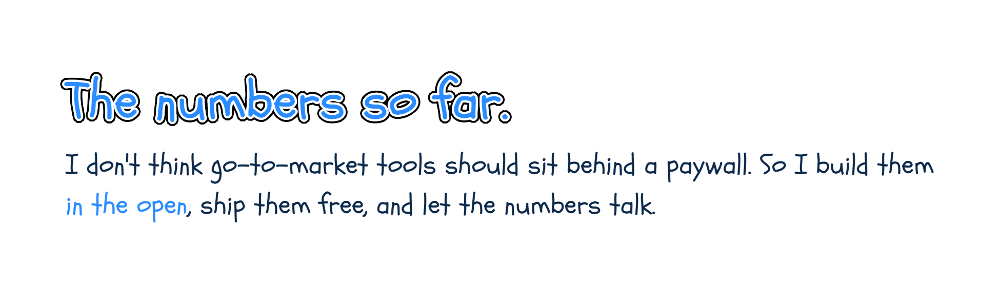

  

  <a href="https://github.com/matthewdonsemail-lab/log">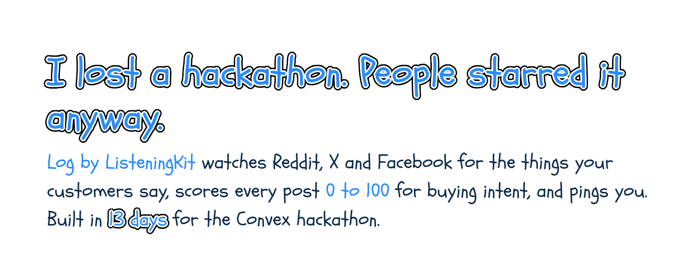</a>

  

  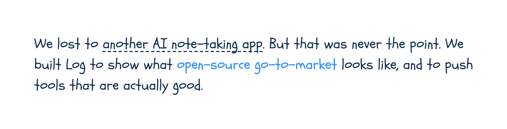

  <a href="https://github.com/matthewdonsemail-lab/log">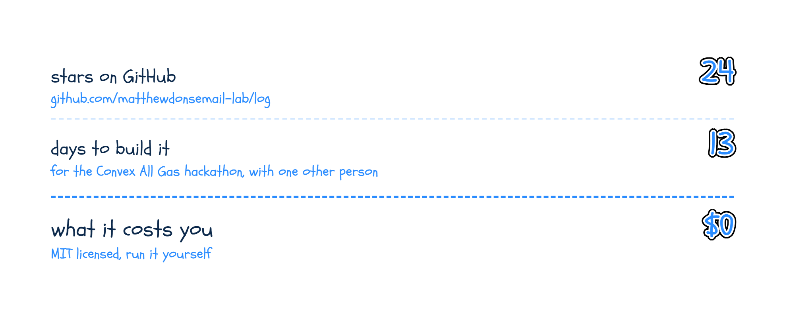</a>

  <a href="https://github.com/matthewdonsemail-lab/dialer">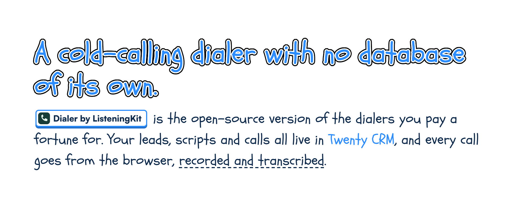</a>

  <a href="https://x.com/matthewsoldit/status/2097872142704754762">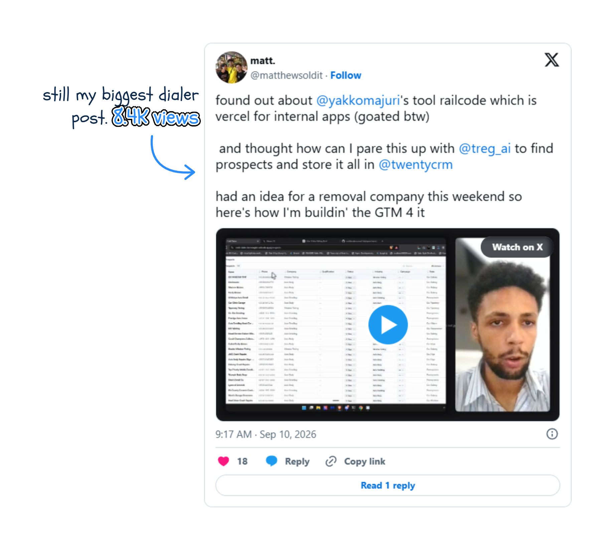</a>

  <a href="https://github.com/matthewdonsemail-lab/dialer">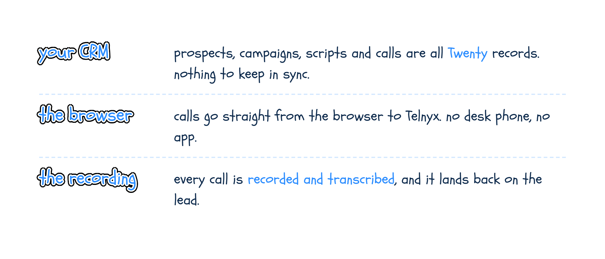</a>

  <a href="https://github.com/matthewdonsemail-lab/dialer">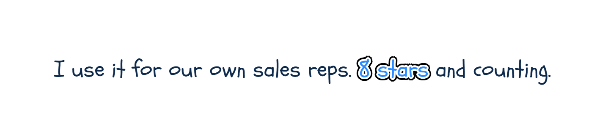</a>

  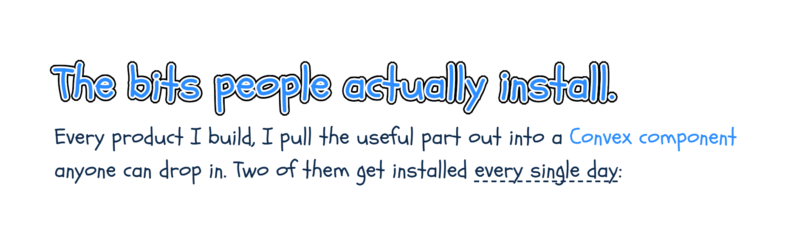

  

  <a href="https://x.com/matthewsoldit/status/2103679605282603009">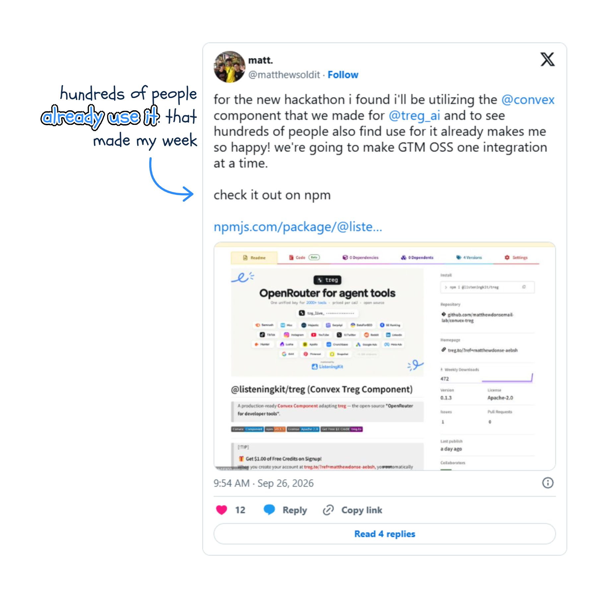</a>

  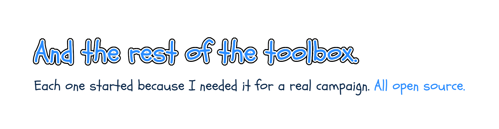

  <a href="https://github.com/matthewdonsemail-lab?tab=repositories">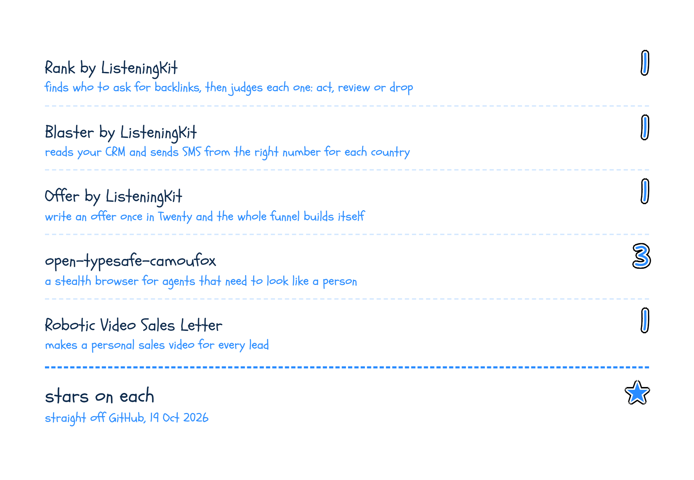</a>

  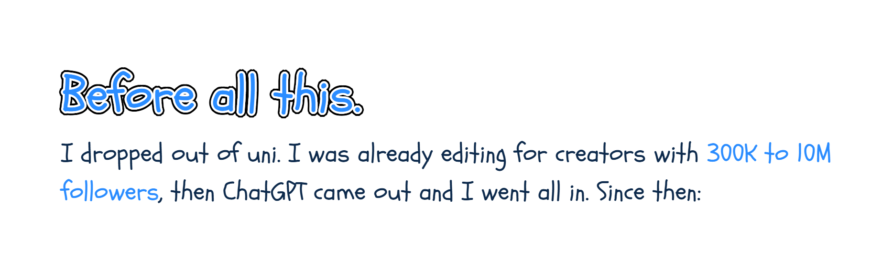

  

  

  

  

  

  

  

